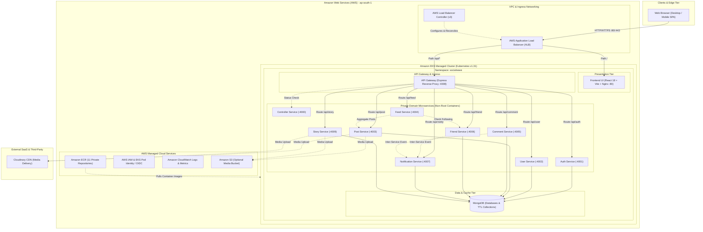
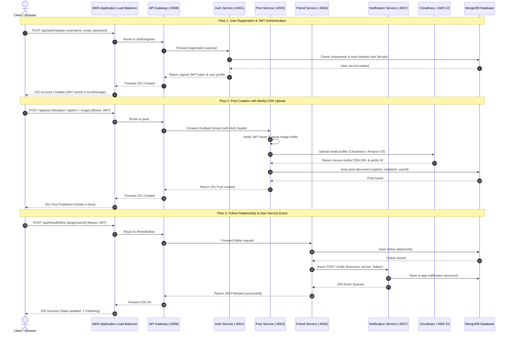
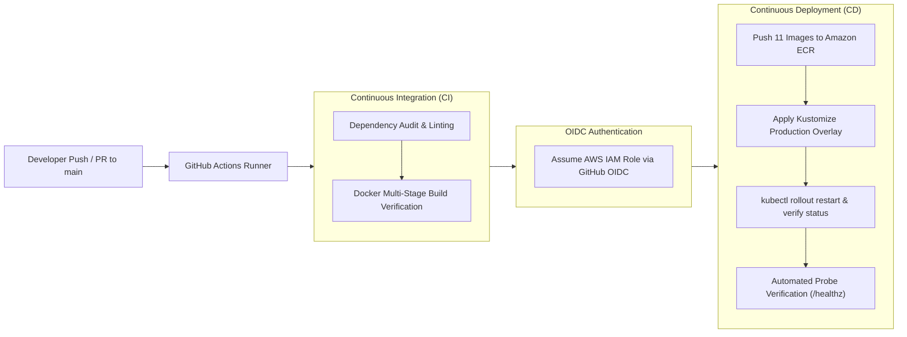

# SocialWave — Enterprise Cloud-Native AWS & Kubernetes Microservices Platform

A resilient, scalable, production-grade social media platform engineered with a **10-microservice distributed architecture**, containerized with Docker, orchestrated on **Amazon EKS (Kubernetes)**, and exposed globally via an **AWS Application Load Balancer (ALB)**.

[](https://aws.amazon.com/)
[](https://kubernetes.io/)
[](https://www.docker.com/)
[](https://github.com/features/actions)
[](https://react.dev/)
[](https://www.mongodb.com/)

---

## 📑 Table of Contents
1. [Architecture Overview](#-architecture-overview)
2. [End-to-End Sequence Diagram](#-end-to-end-sequence-diagram)
3. [CI/CD Deployment Pipeline](#-cicd-deployment-pipeline)
4. [Microservices Matrix & Port Mappings](#-microservices-matrix--port-mappings)
5. [Key Cloud & DevOps Engineering Highlights](#-key-cloud--devops-engineering-highlights)
6. [Interactive Frontend & Features](#-interactive-frontend--features)
7. [Quick Start: Local Development ($0 Cost)](#-quick-start-local-development-0-cost)
8. [Deploying to Amazon Web Services (AWS EKS)](#-deploying-to-amazon-web-services-aws-eks)
9. [Student Cost-Control & Teardown Guide](#-student-cost-control--teardown-guide)
10. [Documentation Suite](#-documentation-suite)

---

## 🏛️ Architecture Overview

The system follows an enterprise **API Gateway pattern** where all external traffic enters via an AWS Application Load Balancer, route-proxies into private Kubernetes pods, and enforces strict boundary isolation through Kubernetes NetworkPolicies.



---

## 🔄 End-to-End Sequence Diagram

This sequence diagram depicts real-world inter-service interactions across authentication, media upload, and asynchronous notification delivery:



---

## 🚀 CI/CD Deployment Pipeline

Fully automated continuous integration and continuous deployment using **GitHub Actions** and **AWS IAM OIDC Federation** (no long-lived access keys in GitHub Secrets):



---

## 🧩 Microservices Matrix & Port Mappings

Every microservice is built to be modular, self-contained, and compliant with cloud-native 12-factor principles:

| Service | Internal Port | Primary Responsibility | Data Isolation | Health Probe | Container Security |
| :--- | :---: | :--- | :---: | :---: | :---: |
| **Frontend** | `80` | React 18 SPA served via optimized Nginx | Static Web | `GET /healthz` | Non-Root (Nginx) |
| **API Gateway** | `4008` | Reverse proxy, path normalization, request routing | Stateless | `GET /healthz` | `USER node` (1000) |
| **Controller Service** | `4000` | Dynamic service health toggle & circuit breaker | In-Memory | `GET /healthz` | `USER node` (1000) |
| **Auth Service** | `4001` | User registration, Bcrypt hashing, JWT issuance | `auth-db` | `GET /healthz` | `USER node` (1000) |
| **User Service** | `4002` | Public profiles, user search, lazy profile sync | `user-db` | `GET /healthz` | `USER node` (1000) |
| **Post Service** | `4003` | Post CRUD, like/unlike, bookmark/save, repost | `post-db` | `GET /healthz` | `USER node` (1000) |
| **Feed Service** | `4004` | Personalized timeline aggregation | Aggregator | `GET /healthz` | `USER node` (1000) |
| **Comment Service** | `4005` | Post comments and interaction alerts | `comment-db` | `GET /healthz` | `USER node` (1000) |
| **Friend Service** | `4006` | Follow/unfollow, follower lists, recommendations | `friend-db` | `GET /healthz` | `USER node` (1000) |
| **Notification Service** | `4007` | Real-time user notification tracking and status | `notify-db` | `GET /healthz` | `USER node` (1000) |
| **Story Service** | `4009` | 24h expiring stories with MongoDB TTL auto-cleanup | `story-db` | `GET /healthz` | `USER node` (1000) |

---

## 🛡️ Key Cloud & DevOps Engineering Highlights

### 1. Cloud-Native Kubernetes (Amazon EKS)
- **Kustomize Architecture**: Clean separation between `k8s/base/` (common manifests) and environment overlays (`k8s/overlays/dev/` and `k8s/overlays/prod/`).
- **AWS Load Balancer Controller v3**: Automatically binds Ingress resources directly to native AWS Application Load Balancers with IP-target routing.
- **Horizontal Pod Autoscaling (HPA)**: Auto-scales microservice deployments based on CPU (70%) and Memory (80%) thresholds.
- **Zero-Downtime Rolling Updates**: Configured with `maxSurge: 25%` and `maxUnavailable: 0` alongside graceful `SIGTERM` / `SIGINT` process shutdown handlers.

### 2. Container Hardening & Security
- **Non-Root Execution**: Every Docker container runs as `USER node` (UID 1000) rather than root, minimizing the container breakout attack surface.
- **Micro-Segmentation via NetworkPolicies**: Strict Kubernetes NetworkPolicies block direct external traffic to internal microservices; only the API Gateway and internal services can communicate.
- **Multi-Stage Builds**: Docker images are built using minimal Alpine bases, stripping devDependencies and build tools from final production images.

### 3. Modular Media Storage Adapter
- Supports both **Cloudinary** (default) and **Amazon S3** through a unified media adapter (`storage.js`).
- Switch providers without code changes simply by setting `STORAGE_PROVIDER=s3` or `STORAGE_PROVIDER=cloudinary`.

---

## 🎨 Interactive Frontend & Features

- **Personalized Feed & Stories**: Infinite scrolling posts, like/unlike animations, comment threads, and 24-hour expiring stories.
- **User Discovery & Profile Management**: Follow/unfollow recommendations, customizable bios, and avatar upload support.
- **Dynamic Theme Switcher**:
  - One-click toggle between **Light Mode** and **Deep Dark Mode**.
  - Persistent state saved to `localStorage` and synchronized with the browser's OS color scheme preference.
  - Accessible from the sidebar, mobile navigation bar, and login/registration screens.

---

## ⚡ Quick Start: Local Development ($0 Cost)

Run the entire 12-container microservices platform locally using Docker Compose:

```bash
# 1. Clone the repository
git clone https://github.com/AyushiVerma791/SocialWave.git
cd SocialWave

# 2. Configure environment variables
cp .env.example .env

# 3. Build and launch all 12 services
docker compose build
docker compose up -d

# 4. Access the applications
# Frontend SPA:          http://localhost:3000
# API Gateway:           http://localhost:4008
# Controller Dashboard:  http://localhost:4000
```

---

## ☁️ Deploying to Amazon Web Services (AWS EKS)

### Prerequisites
- [AWS CLI v2](https://aws.amazon.com/cli/) configured (`aws configure`)
- [Docker](https://www.docker.com/) running locally
- [kubectl](https://kubernetes.io/docs/tasks/tools/) installed

### Automated One-Click Deployment:

```powershell
# 1. Build & Push All 11 Microservices to Amazon ECR
.\scripts\ecr-build-and-push.ps1 -Region ap-south-1 -AccountId <YOUR_ACCOUNT_ID>

# 2. Provision EKS Cluster, Nodegroup, and Deploy Kubernetes Manifests
.\scripts\eks-cluster-setup.ps1 -Region ap-south-1 -AccountId <YOUR_ACCOUNT_ID>

# 3. Retrieve Live AWS ALB Hostname
kubectl get ingress -n socialwave
```

*(For Linux/macOS, use the equivalent shell scripts in `scripts/ecr-build-and-push.sh` and `scripts/eks-cluster-setup.sh`)*

---

## 💰 Student Cost-Control & Teardown Guide

This project is optimized for student learning and budget control. By utilizing **`t3.small` Free-Tier eligible instances** in AWS region `ap-south-1` (Mumbai), testing the full stack for **2 to 3 hours** costs only **~₹50 to ₹70 INR (~$0.60 to $0.85 USD)**.

### Immediate Teardown Script:
To prevent ongoing charges, terminate all cloud resources with one command:

```powershell
# Windows PowerShell
.\scripts\aws-cleanup.ps1 -Region ap-south-1

# Linux / macOS
./scripts/aws-cleanup.sh ap-south-1 false
```

The cleanup script automatically:
1. Deletes the Kubernetes Ingress to trigger ALB de-provisioning.
2. Removes all Kubernetes workloads and services.
3. Deletes the managed EKS nodegroup.
4. Deletes the EKS cluster and IAM OIDC provider.

---

## 📚 Documentation Suite

For in-depth guides and architectural design documents:

- 📖 **[System Architecture & Data Flows](docs/architecture.md)** — Deep dive into request routing, gateway proxying, and event flows.
- 📐 **[High-Level & Low-Level Design (HLD/LLD)](SocialWave_HLD_LLD.md)** — Comprehensive microservice architecture schemas, entity relations, and system designs.
- 💻 **[Local Development & Docker Compose](docs/local-setup.md)** — Troubleshooting and setting up local multi-container development.
- ☁️ **[AWS Infrastructure & ECR Setup](docs/aws-setup.md)** — EKS cluster creation, IAM OIDC permissions, and ALB controller installation.
- ☸️ **[Kubernetes Deployment & Troubleshooting](docs/kubernetes-deployment.md)** — Kustomize overlays, probes, and debugging commands.
- 🔄 **[GitHub Actions CI/CD with AWS OIDC](docs/cicd.md)** — Zero-secret AWS authentication with GitHub Actions.
- 💸 **[Cost Control & Teardown Procedures](docs/cost-and-cleanup.md)** — Detailed AWS billing breakdown and resource removal checklist.

---

<p align="center">
  <b>Engineered with ❤️ for Cloud Architecture, Kubernetes, and DevOps Excellence.</b>
</p>
