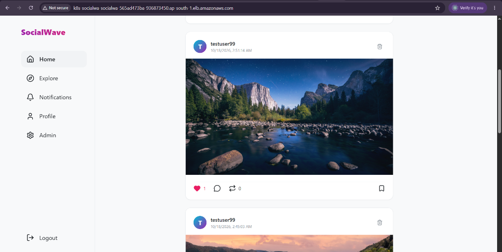
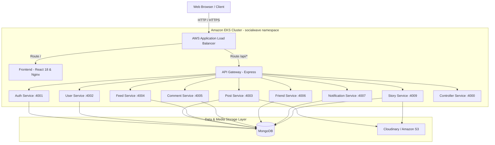
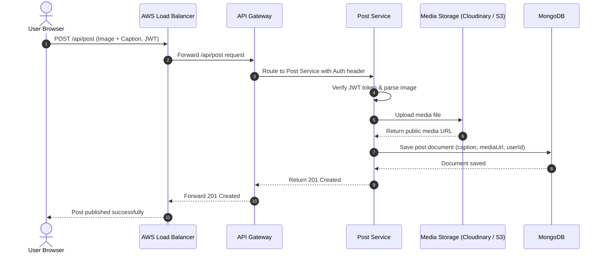
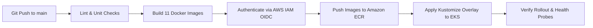

# SocialWave

Cloud-Native Microservices Platform on AWS and Kubernetes.

SocialWave is an Instagram-like social media application engineered with a distributed microservices architecture. The system is containerized with Docker, orchestrated on Amazon Elastic Kubernetes Service (EKS), and served globally through an AWS Application Load Balancer (ALB).



---

## Overview

SocialWave demonstrates how an existing multi-container application can be transitioned into an enterprise cloud architecture without rewriting application business logic.

Key achievements:
- Transition from local containers to Amazon EKS managed Kubernetes (v1.31).
- Single ingress entrypoint via AWS Application Load Balancer with path-based routing.
- Microservice isolation using Kubernetes NetworkPolicies and ClusterIP networking.
- Non-root container security across all services (`USER node`, UID 1000).
- Automated CI/CD pipeline using GitHub Actions with AWS IAM OIDC federation.
- Dynamic theme switching (Dark/Light mode) with persistent client state.
- Decoupled media storage supporting both Cloudinary and Amazon S3.

---

## System Architecture



---

## Core Request Flow

The following sequence diagram outlines the creation of a post with media, illustrating how requests traverse the load balancer, API gateway, internal microservice, and external storage.



---

## Microservices Breakdown

| Service | Port | Description | Database / Storage | Health Probe |
| :--- | :---: | :--- | :--- | :---: |
| **Frontend** | `80` | React 18 SPA served via Nginx | Static Web | `GET /healthz` |
| **API Gateway** | `4008` | Reverse proxy and request dispatcher | Stateless | `GET /healthz` |
| **Controller Service** | `4000` | Dynamic service health and circuit management | In-Memory | `GET /healthz` |
| **Auth Service** | `4001` | Registration, Bcrypt password hashing, JWT tokens | `auth-db` | `GET /healthz` |
| **User Service** | `4002` | User profiles and account search | `user-db` | `GET /healthz` |
| **Post Service** | `4003` | Posts CRUD, likes, bookmarks, and reposts | `post-db` | `GET /healthz` |
| **Feed Service** | `4004` | Personalized timeline aggregation | Aggregator | `GET /healthz` |
| **Comment Service** | `4005` | Post comments and discussions | `comment-db` | `GET /healthz` |
| **Friend Service** | `4006` | Follow/unfollow relations and recommendations | `friend-db` | `GET /healthz` |
| **Notification Service** | `4007` | In-app user notifications | `notify-db` | `GET /healthz` |
| **Story Service** | `4009` | 24-hour expiring stories with TTL cleanup | `story-db` | `GET /healthz` |

---

## CI/CD Pipeline

The project includes automated deployment workflows in `.github/workflows/`:



Key features:
- **Zero-Secret Authentication**: Uses GitHub Actions OIDC federation to assume an AWS IAM role without storing permanent credentials in the repository.
- **Automated Rollouts**: Rolling updates with zero downtime and probe verification.

---

## Local Development

Run the entire application locally using Docker Compose:

```bash
# 1. Clone repository
git clone https://github.com/AyushiVerma791/SocialWave.git
cd SocialWave

# 2. Configure environment
cp .env.example .env

# 3. Start all containers
docker compose up -d

# 4. Access points
# Frontend:          http://localhost:3000
# API Gateway:       http://localhost:4008
# Controller Admin:  http://localhost:4000
```

---

## Deployment to AWS EKS

Automated deployment scripts are provided in the `scripts/` directory.

### Prerequisites
- AWS CLI configured with appropriate IAM permissions
- Docker running locally
- kubectl installed

### Deployment Steps:

```powershell
# 1. Build and push container images to Amazon ECR
.\scripts\ecr-build-and-push.ps1 -Region ap-south-1 -AccountId <YOUR_ACCOUNT_ID>

# 2. Create EKS cluster and deploy manifests
.\scripts\eks-cluster-setup.ps1 -Region ap-south-1 -AccountId <YOUR_ACCOUNT_ID>

# 3. Get the public Application Load Balancer URL
kubectl get ingress -n socialwave
```

*(Bash versions for Linux/macOS are available in `scripts/ecr-build-and-push.sh` and `scripts/eks-cluster-setup.sh`)*

---

## Infrastructure Teardown

To decommission all deployed AWS resources and Kubernetes workloads:

```powershell
# Windows PowerShell
.\scripts\aws-cleanup.ps1 -Region ap-south-1

# Linux / macOS
./scripts/aws-cleanup.sh ap-south-1 false
```

This de-provisions the Application Load Balancer, EKS managed nodegroup, cluster control plane, and IAM OIDC configurations.

---

## Documentation

Comprehensive guides are available in the repository:

- [System Architecture](docs/architecture.md)
- [High-Level and Low-Level Design (HLD/LLD)](SocialWave_HLD_LLD.md)
- [Local Development Setup](docs/local-setup.md)
- [AWS Infrastructure and Prerequisites](docs/aws-setup.md)
- [Kubernetes Manifests and Troubleshooting](docs/kubernetes-deployment.md)
- [GitHub Actions CI/CD with OIDC](docs/cicd.md)
- [Infrastructure Teardown Guide](docs/cost-and-cleanup.md)

