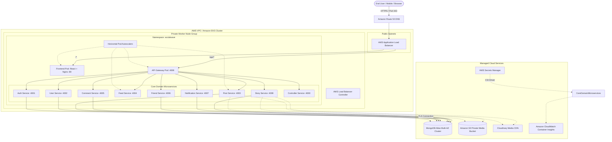

# SocialWave: Cloud-Native Microservices Architecture

## 1. Executive Summary
SocialWave is an Instagram-like social media platform engineered from the ground up to demonstrate enterprise cloud-native patterns. It separates core domain functions into 10 independent microservices, fronted by an API Gateway, served by a React Single Page Application (SPA), containerized with Docker, and orchestrated on Amazon Elastic Kubernetes Service (EKS).

---

## 2. Cloud-Native Target Architecture (AWS EKS)

---

## 3. In-Depth Component Specifications

### 3.1 Network Ingress Layer
- **AWS Application Load Balancer (ALB)**: Provisioned automatically by the `aws-load-balancer-controller` via Kubernetes Ingress rules.
- **Path-Based Routing**:
  - `/api/*` ➔ Routed directly to `api-gateway` (Port 4008).
  - `/*` ➔ Routed to `frontend` (Port 80) serving static assets.
- **Health Checks**: ALB targets continuously poll `/healthz` on target pods with 15s intervals.

### 3.2 Presentation Layer
- **Technology**: React 18 with Vite, React Router v7, and Lucide icons.
- **Containerization**: Multi-stage build on Alpine Linux. Static HTML/JS assets served by an optimized Nginx server configured with client-side routing fallback (`try_files $uri $uri/ /index.html`).

### 3.3 Gateway & Routing Layer
- **Technology**: Express.js with `http-proxy-middleware`.
- **Fault-Tolerance / Circuit Breaker**: Polls `controller-service` status every 10 seconds. If an admin disables a specific microservice, the gateway intercepts requests and returns an immediate `503 Service Unavailable` with friendly metadata, preventing cascaded timeouts.
- **URL Normalizer**: Translates paths seamlessly whether requested as `/api/feed/123` or `/feed/123`.

### 3.4 Domain Microservices
| Microservice | Port | Domain Responsibility | Data Persistence |
| :--- | :--- | :--- | :--- |
| `controller-service` | 4000 | Dynamic service registry & circuit breaker status toggle | In-Memory Registry |
| `auth-service` | 4001 | User registration, Bcrypt hashing, login, JWT issuance | `auth-db` |
| `user-service` | 4002 | Profile retrieval, user search, lazy initialization upsert | `user-db` |
| `post-service` | 4003 | Post CRUD, like/unlike, bookmark/save, repost, media upload | `post-db` |
| `feed-service` | 4004 | Timeline aggregation across friend and post services | Aggregator |
| `comment-service` | 4005 | Post comments, comment threads, post-owner alerts | `comment-db` |
| `friend-service` | 4006 | Follow/unfollow, follower/following lists, recommendations | `friend-db` |
| `notification-service` | 4007 | User interaction alerts (likes, follows, comments) | `notify-db` |
| `story-service` | 4009 | Ephemeral 24h stories, auto-expiration TTL index, views | `story-db` |

---

## 4. Security Architecture

1. **Least Privilege Container Security**:
   - All backend containers execute under the non-root `node` user (`UID 1000`, `GID 1000`).
   - Pod security contexts enforce `runAsNonRoot: true`.
2. **Zero-Trust Network Policies**:
   - Kubernetes `NetworkPolicy` prevents external entities from directly accessing internal backend databases or microservice ports. Only the API Gateway and authorized peer services can dispatch inter-service calls.
3. **Stateless JWT Authentication**:
   - Asymmetric JWT tokens signed by `auth-service` and verified locally in middleware across microservices without gateway bottlenecking.
4. **AWS Secrets Manager Integration**:
   - Sensitive credentials (database URIs, JWT signing secrets, Cloudinary API keys) are not baked into code or Git repositories. They are injected at runtime via Kubernetes Secrets or the AWS Secrets Store CSI Driver.

---

## 5. Storage Strategy: Cloudinary & Amazon S3
The system features a modular storage adapter (`storage.js`):
- **Cloudinary (Default)**: Best for auto-cropping, face detection, and video transcoding.
- **Amazon S3 (AWS-Native Option)**: Set `STORAGE_PROVIDER=s3` to upload media to private S3 buckets, protected with IAM bucket policies and served securely via Amazon CloudFront.
